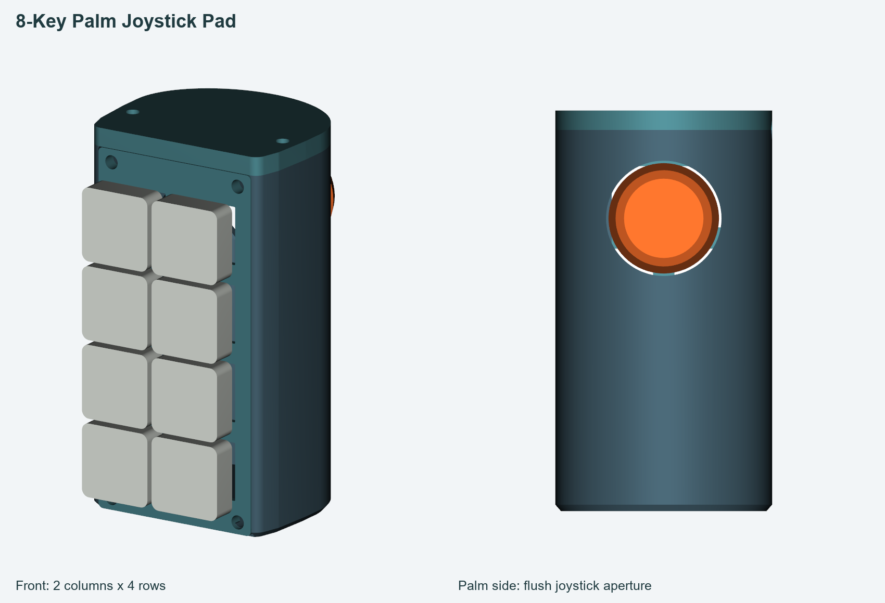
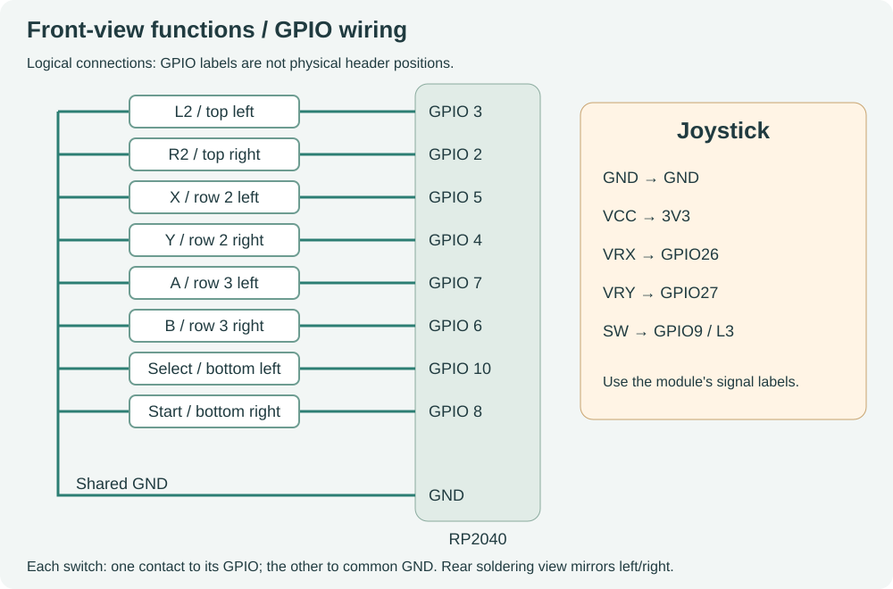
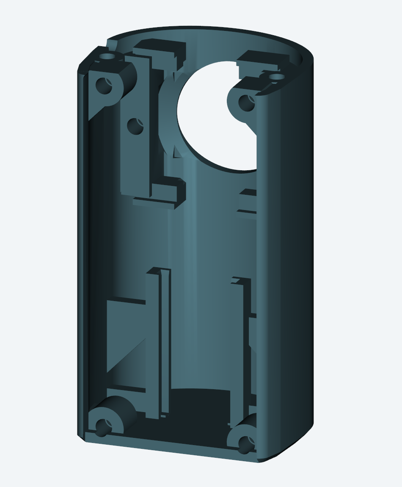
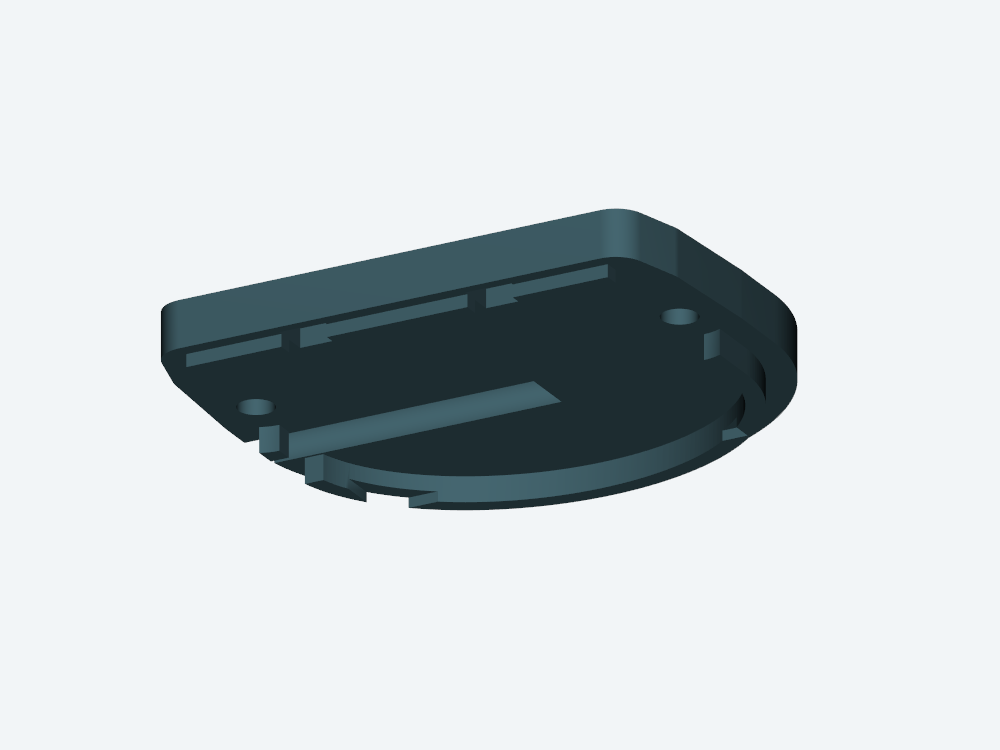

# 8-Key Palm Joystick Pad

A right-hand USB gamepad with **eight MX keys in two columns**, a palm-side analog stick, and a blank top lid. The USB cable connects inside the case and exits through the left side of the body/lid joint.

Download the **3MF print project from the corresponding MakerWorld model page**. Mechanical files are not included in this repository.

## 1. Parts

| Part | Quantity and specification |
| --- | --- |
| Printed case parts | **3**: body, eight-key front plate, and top lid; from MakerWorld |
| RP2040 Pro Micro USB-C board | **1**; nominal 33 × 18 mm PCB; this project's board uses Winbond W25Q32 flash |
| HW-504 / KY-023-style joystick and cap | **1 set**; analog X/Y and SW click; CAD PCB target 34 × 26 × 1.6 mm. Check your module's component outline |
| MX switches and 1U keycaps | **8 of each**; 19.05 mm key pitch |
| M3 machine screws | **6 × M3 × 10 mm**; length measured under the head; flat seating underside, not countersunk |
| M3 heat-set brass inserts | **6**; M3 internal thread, outside diameter approximately 4 mm × length 5 mm |
| Insulated wire and solder | Eight key signal wires, shared GND, and five joystick connections |
| USB data cable | **1**; USB-C at the controller end; cable must fit the 5 mm side exit |
| Silicone adhesive | A small amount to secure the joystick PCB and controller PCB |
| Tools | Soldering iron, cutters, tweezers, and screwdriver; multimeter recommended |

**Screw/insert distribution:** front plate **4**, lid-to-body **2**. Joystick support bores are retained in the body, but this version uses **silicone fixation without separate retaining tabs or pins**, so extra joystick screws/inserts are not required.

## 2. Wiring

Key positions below are viewed **from the front**, with the lid at the top. When soldering from behind, the physical left/right positions are mirrored. Keep the function labels referenced to the front view.

Use **RP2040 GPIO numbers**, not header positions or USB button numbers. This UF2 corrects all four left/right key pairs for the existing wiring:

| Row | Left key | Right key |
| --- | --- | --- |
| 1 — top | GPIO **3** → **L2** | GPIO **2** → **R2** |
| 2 | GPIO **5** → **X** | GPIO **4** → **Y** |
| 3 | GPIO **7** → **A** | GPIO **6** → **B** |
| 4 — bottom | GPIO **10** → **Select** | GPIO **8** → **Start** |

Connect each switch's other electrical contact to a shared **GND**. L2/R2 are **digital buttons**, not analog trigger axes.

| Joystick pad | RP2040 |
| --- | --- |
| GND | GND |
| VCC / 5V marking | **3V3** |
| VRX | **GPIO26** |
| VRY | **GPIO27** |
| SW / stick click | **GPIO9 → L3**, HID button 14 |

**Supply the joystick from 3V3, even if its power pad is marked 5V.** Identify pads by their signal labels; do not assume every module uses the same pin order. GPIO11 is unused.

For software that displays raw HID button numbers: **L2=9, R2=10, X=4, Y=5, A=1, B=2, Select=11, Start=12, L3=14**. GPIO8 is Start in this release; it was Select in the earlier `Handpad8_SW9_Select8.uf2`.

## 3. Assembly

1. **Print and remove supports.** Use the MakerWorld 3MF and select your actual printer, nozzle, material, and plate. Print the body upright, the front plate with its smooth outer face on the bed, and the lid with its outer top face on the bed. Supports are used for the body and front plate; keep the switch retaining lips and open-top controller grooves intact when removing them. The front-plate profile uses a 0.2 mm first layer, **20 mm/s walls**, **25 mm/s fill**, and a **3 mm outer brim**.
2. **Fit six inserts.** Install four in the body's front screw posts and two in the top lid posts. Let them cool before assembly. The two joystick-support bores can remain empty for silicone fixation.
3. **Fit and wire eight switches.** Push the switches into the front plate from outside. Use the front-view wiring table above, solder the individual signal wires and shared GND, and leave enough wire to reopen the case. Keep solder and adhesive out of the switch retaining recesses.
4. **Seat the joystick.** Remove the cap and orient the module with its five signal connections pointing downward. With the front plate and lid removed, lower the PCB through the keyboard-side space, then seat it on the palm-side supports. Refit the cap from outside. The supports are offset **1.5 mm west** to accommodate the off-centre mechanism; the west support is shorter and the east support is longer. Check full stick travel and click clearance, then secure the PCB edges with silicone, keeping the mechanism and contacts clear.
5. **Fit the controller.** Slide the RP2040 down into the two open-top U-grooves, USB socket facing upward and component side toward the keys. Plug in the USB cable **inside** the case. Test the inputs before securing the controller with silicone.
6. **Flash and test.** [Download JoystickPad2.uf2](https://github.com/ddung2ina-lab/joystick_pad2/releases/download/v1.0.0/JoystickPad2.uf2). Hold **BOOT** while connecting to a PC, release it when **RPI-RP2** appears, and copy the UF2 onto that drive. Reconnect normally without BOOT, with the stick centred. The USB product name is **Handpad 8Key L3**. Test all eight keys, both axes, and L3; on Windows, use `Win+R → joy.cpl`.
7. **Close the case.** Secure the front plate with **four M3 × 10 mm screws**. Lay the cable in the west-side semicircular notch, lower the lid so its matching notch completes the round exit, and fit **two M3 × 10 mm screws**. Keep wires away from joints and posts. Remove the lid first when reopening the case.

Viewed down from the lid, **north is the joystick, south is the keyboard, and west is the USB cable exit**. The joystick aperture is a 26.6 mm opening in the body curve, without a separate raised bezel. The lid has internal relief for the offset supports; an older lid can be reused if it closes without interference.

## 4. Downloads and firmware source

- **Print project:** corresponding **MakerWorld model page**; no 3MF/STL files are hosted here.
- **Firmware:** [JoystickPad2.uf2 — v1.0.0](https://github.com/ddung2ina-lab/joystick_pad2/releases/download/v1.0.0/JoystickPad2.uf2), distributed through GitHub Releases.
- **Checksum:** [SHA256SUMS.txt](SHA256SUMS.txt).
- **English assembly manual:** [JoystickPad2_Assembly_Manual_EN.html](docs/JoystickPad2_Assembly_Manual_EN.html). Download and open it locally for the illustrated, printable guide.
- **Editable Arduino sketch:** [Handpad8.ino](firmware/Handpad8/Handpad8.ino).
- **Build instructions and pin mapping:** [firmware/README.md](firmware/README.md).

The UF2 retains the working **W25Q32 boot code**, stick-axis logic, and GPIO9/L3 assignment. All four front-key pairs are exchanged to match the reported physical wiring. Its compiled GPIO/HID table and all 256 boot-code bytes have been checked; the current column correction has not yet been tested on the physical controller.
